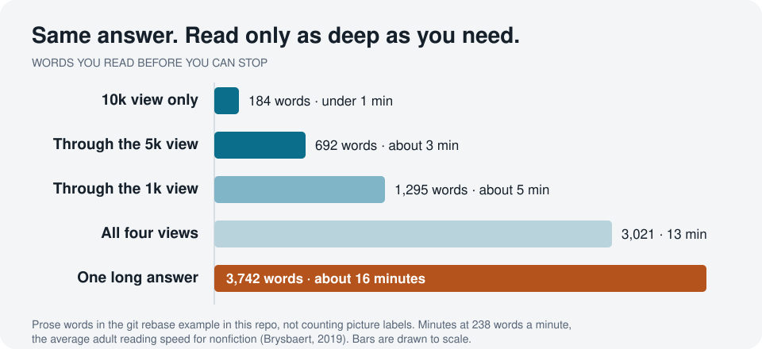
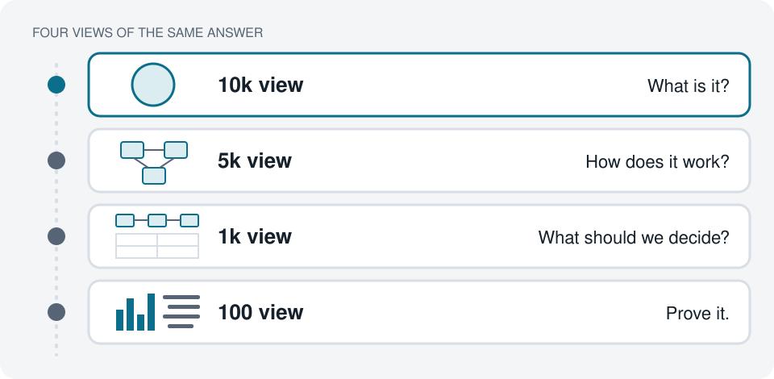
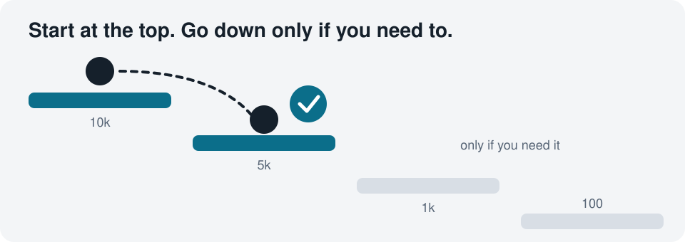

# Altitude

**Read less. Understand faster. Decide sooner.**

Altitude is a skill for coding agents. It turns any answer into one HTML page with four tabs, each a different reading depth of the same topic. You start at the top and go deeper only when you need to.



**[See a live example: git rebase, at altitude →](https://jordanbench.github.io/altitude/examples/git-rebase.html)**
Compare it with [the same answer as one long reply](examples/git-rebase.md).

## Why

Agents write in minutes. You still have to read what they wrote, understand it, and decide what to do next. For a lot of us, that reading step is now the slowest part of the day.

Answers come back the wrong size:

- **Too long,** so you skim and miss the one thing that mattered.
- **Too short,** so you re-ask one level deeper, again and again.

How much you can read also changes through the day. Altitude stops guessing. Every answer comes at four depths, and you pick.

## How it works



| View | Question | What you get |
| --- | --- | --- |
| **10k** | What is it? | Big pictures and few words, written for someone new to the topic |
| **5k** | How does it work? | A diagram of the moving parts and how they connect |
| **1k** | What should we decide? | Risks, trade-offs, and a recommendation |
| **100** | Prove it. | The evidence behind each claim: code, commands, and output |

- The page always opens on the 10k view.
- Each tab opens with its question and a line on when to read it.
- Each tab builds on the one above, so moving down never means starting over.
- Every depth uses pictures, not only the top one.



Most of the time, the 10k and 5k views are enough. They take you from "I don't know what I don't know" to "I know what to ask next."

## Where it helps most

- **Explaining a PR after it's built,** as a sanity check on what the change actually does
- **Getting up to speed on a bug** someone handed you
- **Pitching a complex idea** to people who don't know the area
- **Getting oriented partway through a project,** when you're lost in the weeds

## Install

Altitude is a [Claude Code](https://docs.claude.com/en/docs/claude-code) plugin. This repo is also its own plugin marketplace.

```bash
claude plugin marketplace add jordanbench/altitude
```

```bash
claude plugin install altitude@altitude
```

Then start a new session.

To use the skill without the plugin, copy `skills/altitude/` into `~/.claude/skills/`. The skill is plain Markdown, so you can also point any agent that reads skill files at `skills/altitude/SKILL.md`.

## Use

- Type `/altitude` after any answer to get that answer as four views.
- Type `/altitude <topic>` to start on something new.
- Or ask in plain words, such as "give me the altitude on that."

It's off until you ask. Each session starts with a one-line reminder.

### Modes

Set `ALTITUDE_MODE` in the `env` block of your Claude Code settings:

| Mode | What it does |
| --- | --- |
| `manual` (default) | Views only when you ask. Shows the session-start reminder. |
| `auto` | Also builds views on the first prompt of every session. |
| `suggest` | Also offers views in one line on the first prompt of every session. |
| `off` | No reminder and no hook. `/altitude` still works. |

```json
{
  "env": { "ALTITUDE_MODE": "auto" }
}
```

## What's in this repo

| Path | What it is |
| --- | --- |
| `skills/altitude/SKILL.md` | The skill: what goes in each view and the rules for moving between them |
| `skills/altitude/reference/tab-template.md` | The HTML starting point: tabs, styles, and the tab script |
| `hooks/` | A session-start reminder, and a prompt hook that spots "altitude" in plain words |
| `examples/` | The git rebase example, as an altitude page and as one long answer |
| `tests/` | Contract tests for the prompt hook, standard library only |

Run the tests:

```bash
python3 tests/test_user_prompt_submit.py
```

## Feedback

This is an experiment. If you try it, open an issue and tell me:

- Would you keep it on?
- Did you read less before you could decide?
- Which views did you actually open?

## License

[MIT](LICENSE)
